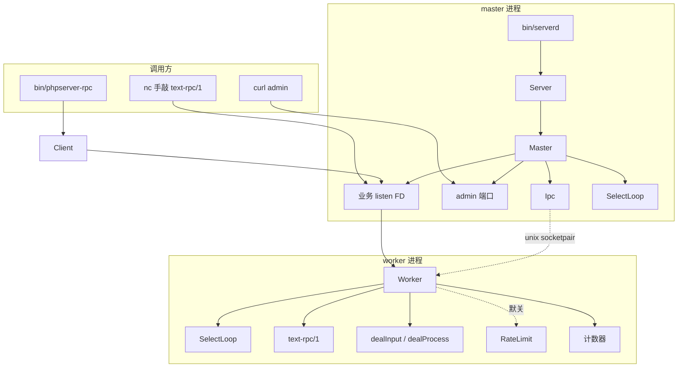
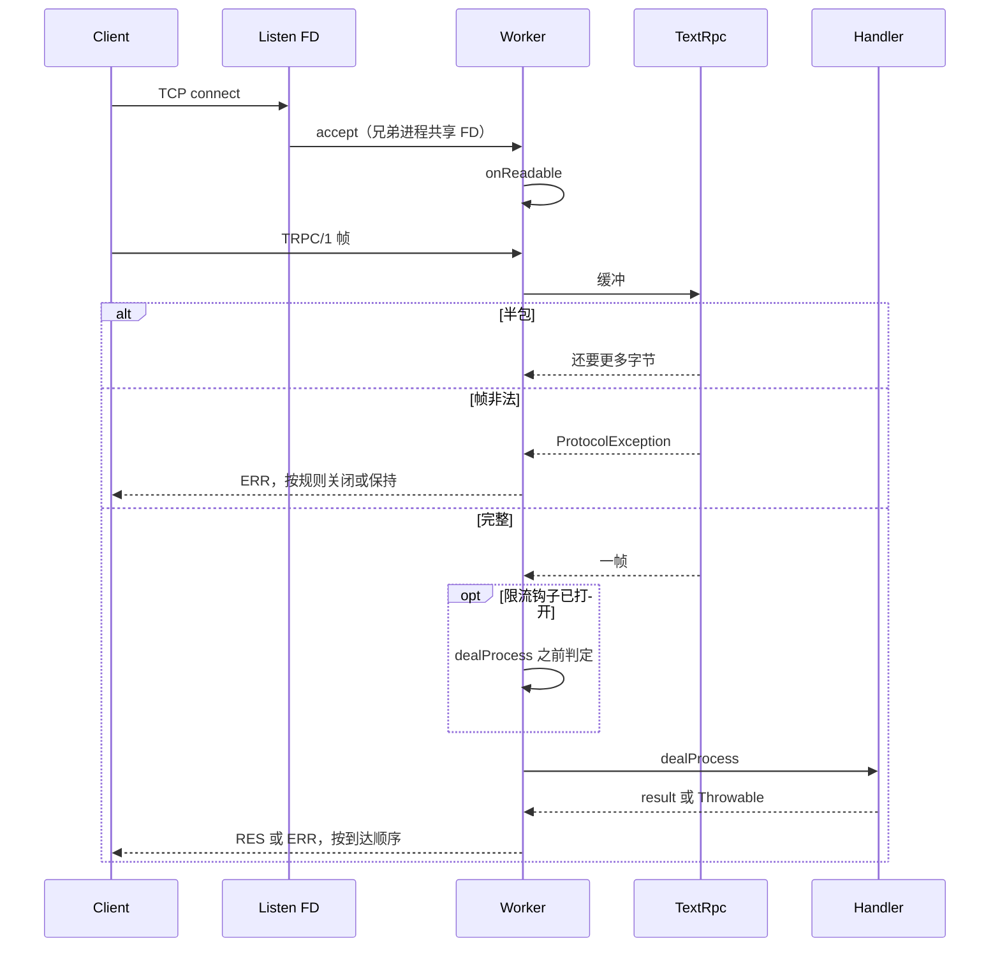

# 路线图

v1 的蓝图。当前仓库停在 **M2**：配置、日志、时钟、异常和 `SelectLoop` 已经在树上，还不能对外提供服务。拆开的任务在 [TODO.md](../TODO.md)。

本文描述要做成的运行时，不描述旧服务器的源码。旧项目只留下三件事：master 预派生 worker、`stream_select` 循环、两个业务钩子（`dealInput` / `dealProcess`）。

## 愿景与原则

做成 2026 年能在 Linux、容器和 Kubernetes 上长期跑的通用薄 RPC 服务器。业务口跑 **text-rpc/1**，管理口跑探针和指标。开发者用单进程和官方客户端把一次调用跟到日志里的 request-id。

- **simple and slight。** 一个 master、若干相同的 worker、两个钩子。不建 DI 容器、插件总线、通用 HTTP 栈。
- **零运行时依赖。** `composer.json` 的 `require` 只有 PHP `>=8.3` 和扩展 `pcntl`、`posix`、`sockets`。探针、指标、日志、限流示例都用标准库。
- **面向 Kubernetes。** 配置是 PHP 数组加 `PHPSERVER_*` 环境变量。默认非 root，日志走 stdout，用 `SIGTERM` 排空。`/healthz`、`/readyz`、`/status`、`/metrics` 在独立 admin 端口上，不挂在业务端口。
- **可观测、可调试。** 文本或 JSON 行日志，每条请求有 request-id。异常变成协议错误，不静默丢掉。`bin/worker` 单进程前台跑，`bin/phpserver-rpc` 像 curl 一样打一帧。verbose 打开时 body 默认截断。
- **现代 PHP。** 全文件 `strict_types`，类默认 `final`，能 `readonly` 就 `readonly`，封闭集合用 enum。风格是 PER Coding Style，静态分析是 PHPStan level max。最低 8.3，CI 同时跑 8.4。

SemVer 只承诺带 `@api` 的类型、CLI 参数、配置键、admin 路径、指标名，以及线协议版本 `text-rpc/1`。库版本和协议版本分开记在 `CHANGELOG.md`。

## 目标架构

v1 运行时如下。M5 之前没有 master；M4 的首切是下面这张图里的单个 worker 加客户端。

一次业务请求走 worker，不经过 admin：

### 组件

| 组件 | 角色 |
|------|------|
| `bin/serverd` | 生产入口：`start` / `stop` / `restart` / `reload` / `status`。容器里用 `--foreground` 当 PID 1。 |
| `bin/worker` | 没有 master 的前台进程，日志直接打到 stdout，用来复现一个 worker。 |
| `bin/phpserver-rpc` | 官方调用 CLI。组 text-rpc/1 帧、打印 request-id 和错误码。 |
| `Server` | 公开门面：`Server::fromConfig(...)->run()`。M5 才出现。 |
| `Master` | 创建 listen FD，fork N 个 worker，处理信号和回收。admin 端口属于 master，不单独再起进程。 |
| `Worker` | 自己的事件循环里 `accept`，用 `dealInput` / `dealProcess` 处理连接。业务只继承这一层。 |
| `Ipc` | master 与 worker 之间的 unix socketpair。定长头加命令 enum，不用 `serialize`。 |
| `SelectLoop` | v1 唯一的事件后端。实现 `LoopInterface`。 |
| text-rpc/1 | 头行 `TRPC/1 <kind> <id> <codec> <len> [trace-id]`，接着恰好 `len` 字节 body，再一个换行。v1 的 codec 只有 `json`（心跳用 `-`）。 |
| `Client` | 阻塞客户端。CLI 和以后的 `benchmarks/rpc/bench.php` 共用，不依赖服务端类。 |
| Admin | master 上的小 HTTP：`GET /healthz`、`/readyz`、`/status`、`/metrics`。只解析 GET，有读超时和大小上限。 |
| `RateLimit` | `dealProcess` 之前的可选钩子，默认关闭。边缘（Ingress、网关、mesh）才是限流的主平面。 |

worker 和 master 各自跑一个循环。一拍的顺序是：**信号 → 定时器 → select**。

1. 处理已经入队的信号。`pcntl_signal` 的处理函数只记下信号编号，并打开 `pcntl_async_signals(true)`。回调在循环线程里跑。
2. 用这一拍读到的一次单调时间，跑到期定时器。时间是整数纳秒。周期定时器先改下一次到期，再执行回调，补跑最多一次。
3. 若调用过 `stop()`，这一拍到此返回。没有被监视的东西时，`run()` 也返回。
4. 有流则对集合的副本做 `stream_select`。`EINTR` 进入下一拍，不当成断连。没有流时用 `time_nanosleep`，**不放占位 FD**，也不对空集调用 `stream_select`。
5. 先读回调，再写回调。

`TimerQueue` 用最小堆加 id 表。表是准的；`cancel` 只从表里删掉 id，堆里的旧条目等到冒泡到堆顶再丢掉。

`stop()` 从定时器回调里调用时，当前这批定时器跑完就返回。从流回调里调用时，当前这批读/写回调跑完，**下一拍还会再跑一次定时器**，然后返回。后一种要不要改，还没定，见 [TODO.md](../TODO.md) 的「已知后续」。

### 模块边界

`src/` 最多两层，`Protocol/TextRpc` 是唯一的第二层。依赖向下：`bin` → `Server` → `Master` → `Worker` → {`Event`, `Protocol`, `Ipc`, `Log`, `Metrics`} → `Support`。`Protocol` 和 `Support` 不依赖其它模块。`Client` 只依赖 `Protocol`。`examples/`、`benchmarks/`、`tests/` 只依赖 `src/`，`src/` 不依赖它们。`Admin` 和 `RateLimit` 可以关掉，核心照常跑。

已经落地的标注以源码为准：

| 已有代码 | 标注 |
|----------|------|
| `LoopInterface` | `@api` |
| `SelectLoop`、`Timer`、`TimerQueue`、`LoopMetrics` | `@internal` |
| `PhpServerException`、`ConfigException`、`ProtocolException`、`RateLimitedException`、`ProcessException` | `@api` |
| `LoggerInterface`、`LogLevel`、`RequestId` | `@api` |
| `StdoutLogger`、`BodyTruncator` | `@internal` |
| `Config`、`ConfigLoader`、`WorkerConfig`、`LogConfig`、`AdminConfig` | `@internal`（公开的是配置键，不是这些类） |
| `ClockInterface`、`SystemClock` | `@internal` |

还没写的模块按下面预定。解析细节、进程实现、指标渲染类保持 `@internal`；指标**名**、admin **路径**、配置**键**、CLI 参数是公开契约。

| 预定路径 | 公开什么 |
|----------|----------|
| `src/Server.php` | 类本身 `@api` |
| `src/Worker/` | `WorkerInterface`、`AbstractWorker`、`RpcWorker` 是业务继承面 |
| `src/Protocol/`、`src/Protocol/TextRpc/` | `ProtocolInterface` 与 `ErrorCode`；`FrameDecoder` / `FrameEncoder` 为 `@internal` |
| `src/Client/` | 客户端 `@api` |
| `src/RateLimit/` | `LimiterInterface` `@api` |
| `src/Master/`、`src/Ipc/`、`src/Admin/`、`src/Metrics/`、`src/Support/` | `@internal` |

子命名空间：`Exception`、`Config`、`Log`、`Support`、`Event`、`Protocol`、`Protocol\TextRpc`、`Worker`、`Master`、`Ipc`、`Metrics`、`Admin`、`RateLimit`、`Client`。

## 里程碑

依赖：`M1 → {M2, M3} → M4 → M5 → M6 → M7`。M2 与 M3 可以并行。M4 是首切：单进程服务端加官方客户端能把一次调用跑通。

| 里程碑 | 目标 | 关键交付 | 验收 | 状态 |
|--------|------|----------|------|------|
| M1 | 骨架、工具链、基础件 | [Config](../src/Config/)、[Log](../src/Log/)、[Support](../src/Support/)、[Exception](../src/Exception/)、[配置说明](configuration.md)、[CI](../.github/workflows/ci.yml) | `composer test` / `analyse` / `cs` 可跑；校验失败抛 `ConfigException`；JSON 日志行含 `ts`、`level`，有 request-id 时含 `request_id` | ✅ |
| M2 | 唯一的事件循环 | [LoopInterface](../src/Event/LoopInterface.php)、[SelectLoop](../src/Event/SelectLoop.php)、[Timer](../src/Event/Timer.php)、[TimerQueue](../src/Event/TimerQueue.php)、[事件循环说明](event-loop.md) | 空跑一轮无 `TypeError`；无占位 FD；定时器用单调纳秒；信号回调在循环线程执行 | ✅ |
| M3 | 线协议与官方客户端 | `docs/protocol-text-rpc.md`、`src/Protocol/`、`src/Protocol/TextRpc/`、`src/Client/`、`bin/phpserver-rpc` | 半包、粘包、超长、非法 UTF-8 有确定结果；CLI 对测试夹具往返成功 | ⏳ |
| M4 | 首切：单进程 worker | `src/Worker/`、`examples/Echo/`、`examples/Rpc/`、`bin/worker`、`docs/worker-contract.md`、`docs/debugging.md` | Echo 的 HTTP 明文返回 `hello`；RPC 往返带 request-id；Handler 抛异常时进程不退出 | ⏳ |
| M5 | prefork 生产形态 | `src/Master/`、`src/Ipc/`、`src/Server.php`、`bin/serverd`、`docs/operations.md` | N 个 worker；崩溃后拉起；`SIGTERM` 排空；reload 期间请求不失败；`max_requests` 默认关闭 | ⏳ |
| M6 | K8s 探针与指标 | `src/Admin/`、Prometheus 文本、`src/RateLimit/` | admin 上 `/healthz` 与 `/readyz` 为 200；`SIGTERM` 后 `/readyz` 先失败；业务端口不认这些路径 | ⏳ |
| M7 | 压测、镜像、文档，发布 1.0.0 | `benchmarks/`、`deploy/Dockerfile`、`deploy/k8s/`、五份文档定稿 | 镜像非 root；`docker stop` 能排空；README 五条命令内跑起 Echo | ⏳ |

M1 的三个 `bin/` 脚本仍是占位：打印 `not implemented`，状态码 1。`config/server.echo.php` 里的 `EchoWorker` 只是通过校验的类名，类要到 M4 才有。

各里程碑不包含的内容，以及文件级任务，写在 [TODO.md](../TODO.md)。

## 1.0 之后

下面这些**不是 v1 的范围**，1.0.0 不交付，也不要在做 M3–M7 时顺手加进去。

- **更多 codec。** 头行里的 `codec` 已留空位。`msgpack`、`protobuf`（注册名 `proto`）可以以后加，不改帧边界。未知 codec 在 v1 用 `json` 回 `-32004`。
- **别的事件循环。** Fibers，以及 libev / libevent / libuv 一类后端。v1 只有 `SelectLoop`。
- **TechEmpower。** 可选的最小 HTTP plaintext，挂在 `examples/Echo/`，不进核心，也不是 1.0 的前提。
- **`SO_REUSEPORT`、连接亲和。** v1 接受共享 listen FD 上的惊群。M7 的基准负责把 P99 量化，再决定要不要改 listen 模型。
- **OpenTelemetry 或其它 APM。** v1 用日志、request-id 和 `/metrics`。
- **admin 的 mTLS / RBAC。** v1 最多一个可选 token。
- **Thrift、gRPC、把本进程做成通用 HTTP 服务器。**
- **Helm chart、Operator、service mesh。** 示例清单到 Deployment / Service 为止。
- **把 Windows 或 macOS 做成一等平台。** 目标平台是 Linux 和容器。
- **长期并行支持多版线协议，或在 v1 里做乱序回复、notification、batch。** 那些改动属于 `TRPC/2`。
- **把 admin 拆成单独进程，或做异步客户端 / 连接池。**
- **把 `psr/log` 收进 `require`。** 若要改，留到 2.0。`examples/psr3-logger-adapter.php` 只是示例。
- **`inotify` 自动 reload。** 开发机可选项，不阻塞 1.0。K8s 用滚动发布。

## v1 非目标

这些在 v1 **明确不做**，不是「以后第一件事」：

- 不做旧 JM 线协议兼容：无 legacy 模式，无 wire adapter，无旧鉴权信封。
- 不做 Telnet 管理口。运维和 debug 走 admin HTTP。`nc` / `telnet` 只作为**客户端**手敲 text-rpc/1。
- 不把 Swoole、OpenSwoole、RoadRunner、ReactPHP、Revolt 当作核心，也不把 Fibers 当作默认循环。
- 不做公司配额代理，也不做强制的外部策略中心。进程内钩子默认关。
- 不做完整 APM、运维大屏、内嵌抓包 UI、逐 FD 全量 dump。默认不打印完整请求 body。
- 不做 ghz / gRPC 压测栈。
- 不在业务端口上提供 `/healthz`、`/readyz`、`/status`、`/metrics`。
- 不引入 PSR-11、PSR-7 / 15 / 17 / 18、PSR-6 / 16、PSR-14，也不 `require` `psr/log` 或 `psr/clock`。
- 不做 Windows 服务、完整 Helm / Operator、用本进程替换 nginx + php-fpm。
