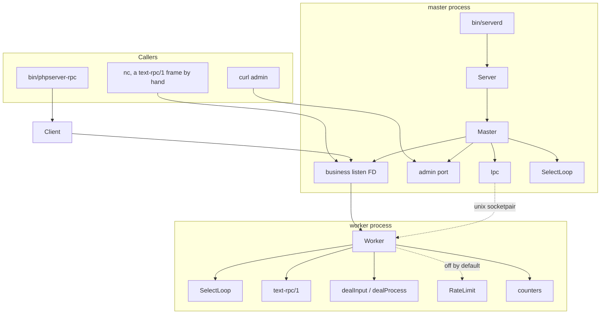
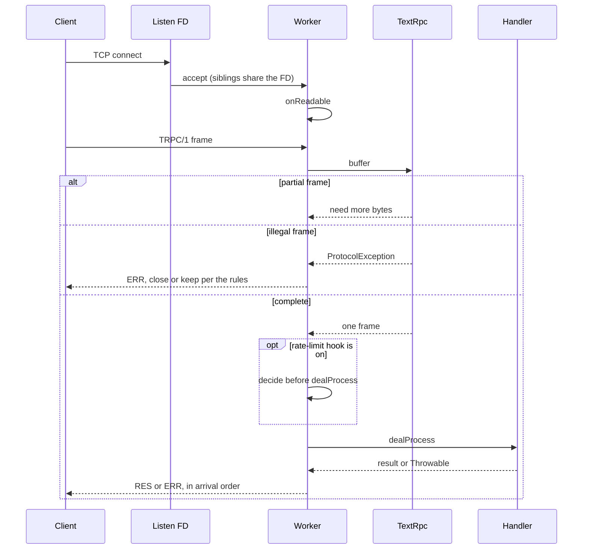

# Roadmap

The v1 blueprint. The repository is at **1.0.0**: config, logging, clock, exceptions, `SelectLoop`, text-rpc/1, the blocking client, the foreground worker, the prefork master, admin probes and metrics, the runtime image, and the Kubernetes example are all in the tree. The task list is [TODO.md](../TODO.md).

This document describes the runtime to build. It does not describe the old server's source. The old project leaves three ideas: a master that preforks workers, a `stream_select` loop, and two business hooks (`dealInput` / `dealProcess`).

## Vision and principles

A thin general RPC server that can run for a long time in 2026 on Linux, in containers, and on Kubernetes. The business port speaks **text-rpc/1**. The admin port serves probes and metrics. A developer follows one call from a single process and the official client to the request-id in the log.

- **Simple and slight.** One master, several identical workers, two hooks. No DI container, no plugin bus, no general HTTP stack.
- **No runtime dependencies.** `composer.json` `require` is only PHP `>=8.3` and the extensions `pcntl`, `posix`, and `sockets`. Probes, metrics, logs, and the rate-limit example use the standard library.
- **Kubernetes-shaped.** Config is a PHP array plus `PHPSERVER_*` environment variables. Non-root by default, logs on stdout, drain on `SIGTERM`. `/healthz`, `/readyz`, `/status`, and `/metrics` are on a separate admin port, not on the business port.
- **Observable and debuggable.** Text or JSON-line logs, and a request-id on each request. An exception becomes a protocol error. It is not dropped silently. `bin/worker` runs one process in the foreground. `bin/phpserver-rpc` sends one frame the way curl does. With verbose on, bodies are truncated by default.
- **Modern PHP.** `strict_types` in every file, classes `final` by default, `readonly` where it fits, enums for closed sets. Style is PER Coding Style. Static analysis is PHPStan level max. The floor is 8.3. CI also runs 8.4.

SemVer covers types marked `@api`, CLI arguments, config keys, admin paths, metric names, and the wire protocol version `text-rpc/1`. The library version and the protocol version are recorded separately in `CHANGELOG.md`.

## Target architecture

The v1 runtime looks like this. There is no master before M5. M4's first cut is one worker from the diagram plus the client.

A business request stays on the worker. It does not pass through admin:

### Components

| Component | Role |
|-----------|------|
| `bin/serverd` | Production entry: `start` / `stop` / `restart` / `reload` / `status`. In a container, `--foreground` is PID 1. |
| `bin/worker` | A foreground process with no master. Logs go straight to stdout. Use it to reproduce one worker. |
| `bin/phpserver-rpc` | The official call CLI. It builds a text-rpc/1 frame and prints the request-id and the error code. |
| `Server` | The public facade: `Server::fromConfig(...)->run()`. |
| `Master` | Creates the listen FD, forks N workers, and handles signals and recycling. The admin port belongs to the master. There is no separate admin process. |
| `Worker` | `accept`s inside its own event loop and handles connections with `dealInput` / `dealProcess`. Business code only extends this layer. |
| `Ipc` | A unix socketpair between master and worker. A fixed-length header plus a command enum. No `serialize`. |
| `SelectLoop` | The only event backend in v1. It implements `LoopInterface`. |
| text-rpc/1 | Header line `TRPC/1 <kind> <id> <codec> <len> [trace-id]`, then exactly `len` body bytes, then a newline. The v1 codecs are `json` and `-` for heartbeats. |
| `Client` | The blocking client. The CLI and `benchmarks/rpc/bench.php` share it. It does not depend on server classes. |
| Admin | A small HTTP server on the master: `GET /healthz`, `/readyz`, `/status`, `/metrics`. It parses GET only, with a read timeout and a size cap. |
| `RateLimit` | An optional hook before `dealProcess`, off by default. The edge (Ingress, gateway, mesh) is the primary place to rate-limit. |

The worker and the master each run one loop. One tick is **signals, then timers, then select**.

1. Drain signals that are already queued. The `pcntl_signal` handler only records the signal number and turns on `pcntl_async_signals(true)`. The callback runs on the loop thread.
2. Run due timers from one monotonic reading for the tick. Time is integer nanoseconds. A periodic timer updates its next due time before the callback, and catch-up is at most one firing.
3. If `stop()` was called, the tick returns here. If nothing is watched, `run()` returns too.
4. If there are streams, `stream_select` the copies of the sets. `EINTR` starts the next tick and is not a disconnect. With no streams, sleep with `time_nanosleep`. **Do not park a placeholder fd**, and do not call `stream_select` on empty sets.
5. Read callbacks first, then write callbacks.

`TimerQueue` is a min-heap plus an id table. The table is authoritative. `cancel` only deletes the id from the table. A stale heap entry is dropped when it bubbles to the top.

When `stop()` is called from a timer callback, `run()` returns after the current batch of timers. When it is called from a stream callback, the current read and write callbacks finish, **the next tick runs timers once more**, and then `run()` returns. Whether to change the second case is still open. See "Known follow-ups" in [TODO.md](../TODO.md).

### Module boundaries

`src/` is at most two levels deep. `Protocol/TextRpc` is the only second level. Dependencies point downward: `bin` → `Server` → `Master` → `Worker` → {`Event`, `Protocol`, `Ipc`, `Log`, `Metrics`} → `Support`. `Protocol` depends only on `Exception`. `Support` depends on no other module. `Client` depends on `Protocol`, `Exception`, and `Support` (call deadlines are monotonic nanoseconds). The CLI uses `Log\BodyTruncator` to truncate `-v` frames. `Worker` depends on `Config`, `Event`, `Protocol`, `Log`, `Metrics`, `Support`, and `Exception`. `Metrics` depends on no other module. `examples/`, `benchmarks/`, and `tests/` depend only on `src/`. `src/` does not depend on them. `Admin` and `RateLimit` can be turned off. The core still runs.

The annotations that have landed follow the source:

| Code | Mark |
|------|------|
| `LoopInterface` | `@api` |
| `SelectLoop`, `Timer`, `TimerQueue`, `LoopMetrics` | `@internal` |
| `PhpServerException`, `ConfigException`, `ProtocolException`, `RateLimitedException`, `ProcessException` | `@api` |
| `LoggerInterface`, `LogLevel`, `RequestId` | `@api` |
| `StdoutLogger`, `BodyTruncator` | `@internal` |
| `Config`, `ConfigLoader`, `WorkerConfig`, `LogConfig`, `AdminConfig` | `@internal` (the config keys are public, not these classes) |
| `ClockInterface`, `SystemClock` | `@internal` |
| `ProtocolInterface`, `ErrorCode` | `@api` |
| `FrameDecoder`, `FrameEncoder`, `JsonCodec`, frame types | `@internal` |
| `Client`, `Response`, `RpcError`, `NetworkException` | `@api` |
| `Console` (client) | `@internal` (the CLI arguments and exit codes are public) |
| `WorkerInterface`, `AbstractWorker`, `RpcWorker`, `Input`, `Output`, `InputState` | `@api` |
| `Connection`, worker `Console` | `@internal` (`bin/worker` arguments and exit codes are public) |
| `Counters`, `MasterCounters` | `@internal` (counter names are public, not the render format) |
| `Server` | `@api` |
| `Master`, `Ipc`, `Admin` types, `PrometheusText` | `@internal` (signals, the CLI, admin paths, counter names, and metric names are public) |
| `LimiterInterface`, `Decision`, `TokenBucket` | `@api` |

1.0.0 is released. Metric names, admin paths, config keys, and CLI arguments are public contracts. Benchmark numbers are not part of the version promise. `SO_REUSEPORT` stays after 1.0.

Sub-namespaces: `Exception`, `Config`, `Log`, `Support`, `Event`, `Protocol`, `Protocol\TextRpc`, `Worker`, `Master`, `Ipc`, `Metrics`, `Admin`, `RateLimit`, `Client`.

## Milestones

Dependencies: `M1 → {M2, M3} → M4 → M5 → M6 → M7`. M2 and M3 can run in parallel. M4 is the first cut: a single-process server plus the official client complete one call.

| Milestone | Goal | Delivered | Acceptance | Status |
|-----------|------|-----------|------------|--------|
| M1 | Skeleton, toolchain, basics | [Config](../src/Config/), [Log](../src/Log/), [Support](../src/Support/), [Exception](../src/Exception/), [configuration](configuration.md), [CI](../.github/workflows/ci.yml) | `composer test` / `analyse` / `cs` run; a bad config throws `ConfigException`; a JSON log line has `ts` and `level`, and `request_id` when there is one | ✅ |
| M2 | The only event loop | [LoopInterface](../src/Event/LoopInterface.php), [SelectLoop](../src/Event/SelectLoop.php), [Timer](../src/Event/Timer.php), [TimerQueue](../src/Event/TimerQueue.php), [event loop](event-loop.md) | One empty run has no `TypeError`; no placeholder fd; timers use monotonic nanoseconds; signal callbacks run on the loop thread | ✅ |
| M3 | Wire protocol and official client | [protocol-text-rpc.md](protocol-text-rpc.md), [Protocol](../src/Protocol/), [TextRpc](../src/Protocol/TextRpc/), [Client](../src/Client/), [bin/phpserver-rpc](../bin/phpserver-rpc) | Partial frames, coalesced frames, oversize frames, and illegal UTF-8 have a defined result; the CLI round-trips the test fixture | ✅ |
| M4 | First cut: one worker process | [Worker](../src/Worker/), [Counters](../src/Metrics/Counters.php), [Echo](../examples/Echo/), [Rpc](../examples/Rpc/), [bin/worker](../bin/worker), [worker contract](worker-contract.md), [debugging](debugging.md) | Echo's HTTP plaintext returns `hello`; an RPC round-trip carries a request-id; a thrown handler does not exit the process | ✅ |
| M5 | Prefork production shape | [Master](../src/Master/), [Ipc](../src/Ipc/), [Server](../src/Server.php), [bin/serverd](../bin/serverd), [operations](operations.md) | N workers; a crash is replaced; `SIGTERM` drains; requests succeed during reload; `max_requests` defaults off | ✅ |
| M6 | Kubernetes probes and metrics | [Admin](../src/Admin/), [Prometheus text](../src/Metrics/PrometheusText.php), [RateLimit](../src/RateLimit/) | Admin `/healthz` and `/readyz` are 200; after `SIGTERM`, `/readyz` fails first; the business port does not recognize these paths | ✅ |
| M7 | Benchmarks, image, docs, 1.0.0 | [`benchmarks/`](../benchmarks/README.md), the root [`Dockerfile`](../Dockerfile) `runtime` target, [`deploy/k8s/`](../deploy/k8s/README.md), the five docs finalized | The image is non-root; Echo comes up within five README commands; both CHANGELOG columns record 1.0.0 / text-rpc/1 | ✅ |

`bin/serverd start --foreground` forks workers from the config and serves `/healthz`, `/readyz`, `/status`, and `/metrics` on the admin port. `bin/worker` can still run one process in the foreground. `bin/phpserver-rpc` can send one frame to the business port.

What each milestone leaves out, and the file-level tasks, are in [TODO.md](../TODO.md).

## After 1.0

The following are **not in v1**. 1.0.0 does not ship them, and they were not to be added on the side while doing M3–M7.

- **More codecs.** The header `codec` field already has room. `msgpack` and `protobuf` (registered name `proto`) can be added later without moving the frame boundary. An unknown codec is answered with `json` and `-32004` in v1.
- **Another event loop.** Fibers, and backends such as libev, libevent, or libuv. v1 has only `SelectLoop`.
- **TechEmpower.** An optional minimal HTTP plaintext, living in `examples/Echo/`. It is not part of the core, and it was not a prerequisite for 1.0.
- **`SO_REUSEPORT` and connection affinity.** v1 accepts the thundering herd on a shared listen FD. The M7 benchmark records P99, and that number is what a later change would use to decide whether to test `SO_REUSEPORT`.
- **OpenTelemetry or another APM.** v1 uses logs, request-id, and `/metrics`.
- **mTLS or RBAC on admin.** v1 has at most one optional token.
- **Thrift, gRPC, or turning this process into a general HTTP server.**
- **A Helm chart, an Operator, or a service mesh.** The sample manifests stop at Deployment and Service.
- **Windows or macOS as a first-class platform.** The target is Linux and containers.
- **Several wire versions in parallel for a long time, or out-of-order replies, notification, and batch inside v1.** Those changes belong to `TRPC/2`.
- **Splitting admin into its own process, or an async client / connection pool.**
- **Moving `psr/log` into `require`.** If that changes, it waits for 2.0. `examples/psr3-logger-adapter.php` is only an example.
- **`inotify` auto-reload.** Optional on a development machine. It does not block 1.0. Kubernetes uses a rolling update.

## Not v1 goals

These are **explicitly not done in v1**. They are not "the first thing afterwards":

- No compatibility with the old JM wire protocol: no legacy mode, no wire adapter, no old auth envelope.
- No Telnet admin port. Operations and debugging use admin HTTP. `nc` and `telnet` are only a **client** typing text-rpc/1 by hand.
- Swoole, OpenSwoole, RoadRunner, ReactPHP, and Revolt are not the core, and Fibers are not the default loop.
- No company quota proxy, and no mandatory external policy center. The in-process hook defaults to off.
- No full APM, operations dashboard, embedded capture UI, or a dump of every fd. The full request body is not printed by default.
- No ghz or gRPC benchmark stack.
- `/healthz`, `/readyz`, `/status`, and `/metrics` are not served on the business port.
- No PSR-11, PSR-7 / 15 / 17 / 18, PSR-6 / 16, or PSR-14, and no `require` of `psr/log` or `psr/clock`.
- No Windows service, no full Helm chart or Operator, and this process does not replace nginx plus php-fpm.
